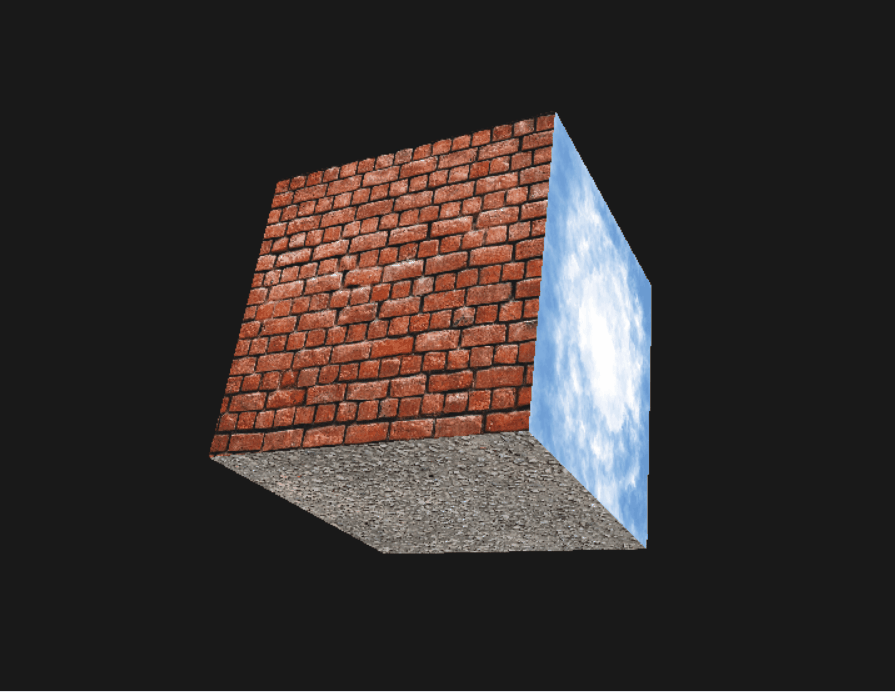

# Лабораторная работа №3

Программа реализует отрисовку вращающегося куба с использованием библиотеки OpenGL, на каждой грани которого находятся различные текстуры.

## Демонстрация выполнения работы программы

## Описание задачи

**Вариант 7:** Создайте программу, отрисовывающую вращающийся куб, на каждой грани которого находятся различные текстуры.

## Программа реализована на языке:

| Язык | Интерпретатор/Версия | Среда разработки |
| :--- | :--- | :--- |
| Python | Python / 3.9+ | PyCharm 2022 3.2 |

**Используемые библиотеки:**
*   `pygame` - для создания окна приложения, обработки событий и загрузки изображений.
*   `PyOpenGL` - для работы с трехмерной графикой (отрисовка граней, наложение текстур, вращение).
*   `numpy` - используется библиотекой PyOpenGL для работы с массивами данных при генерации текстур.

## Описание возможностей:
Программа создает окно с трехмерной сценой, в центре которой находится куб. Куб непрерывно вращается вокруг осей X и Y.
*   На каждую из 6 граней куба накладывается своя уникальная текстура из файлов изображений (`1.jpg`, `2.jpg`, `3.jpg`, `4.jpg`, `5.jpg`, `6.jpg`).
*   Включен тест глубины (Z-buffer), благодаря чему задние грани не перекрывают передние.
*   **Esc** - корректный выход из программы.

## Установка и запуск:

1. Клонируйте репозиторий
2. Перейдите в папку с проектом
3. Запустите программу: python main.py
4. Важно: Убедитесь, что в папке с файлом main.py лежат 6 изображений с названиями 1.jpg, 2.jpg, 3.jpg, 4.jpg, 5.jpg, 6.jpg.
